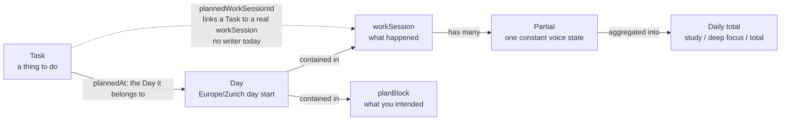
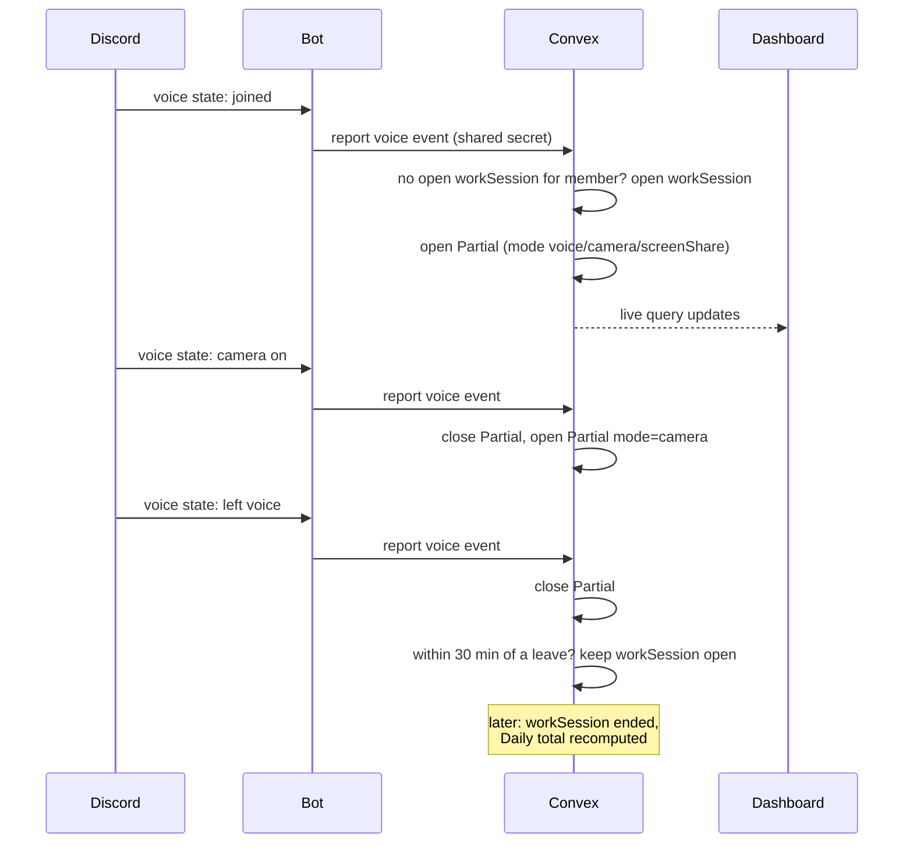
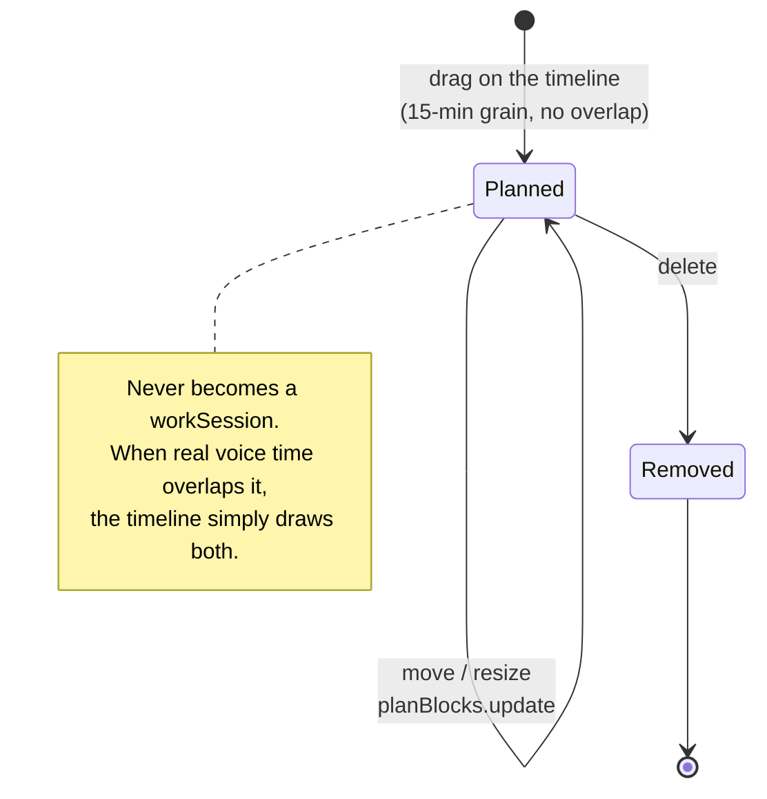
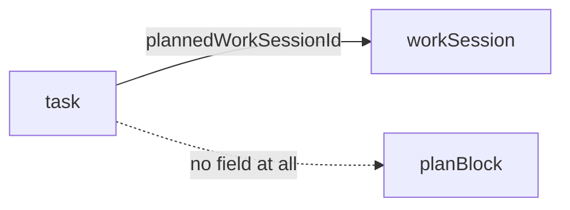
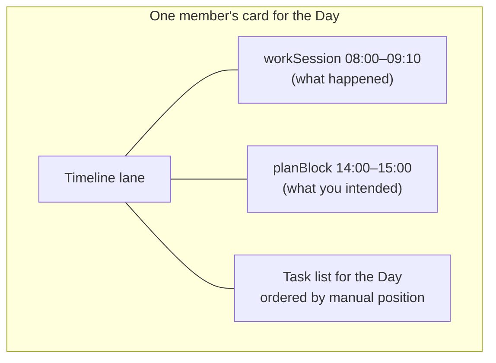

# planBlock vs workSession (and where Tasks sit)

Reference note for the three time-ish things in studytrack. The short version:
a **workSession** is what happened; a **planBlock** is what you intended to
happen; a **Day** is the box both of them live in.

> Source of truth: `packages/backend/convex/schema.ts` and `GLOSSARY.md`.

## The four nouns

- **Day** — `dayStart`, always local midnight in Europe/Zurich. Tasks and
  planBlocks are scoped to a Day. It keeps the backend reading `dayStart` from
  the caller instead of the wall clock.
- **workSession** — a real sitting (`schema.ts:37`). It starts when a member
  joins a study voice channel and ends when they leave voice; re-entering within
  30 minutes continues the same one. It is made of **Partials**.
- **Partial** — one stretch with a constant voice state: same channel, same
  camera / screen-share mode. Pauses (no channel) are partials too.
- **planBlock** — stored in the `planBlock` table (`schema.ts:113`). A future
  block on your own lane: `dayStart`, `plannedStart`, `plannedEnd`. It has **no
  voice evidence and no partials**. It is a promise, not a record.
- **Task** — `schema.ts:93`. Belongs to a Day (`plannedAt`), and _optionally_
  points at a real workSession (`plannedWorkSessionId`).

## A real workSession forms

The bot only reports raw voice states; Convex decides what they mean.

## A planBlock is placed, not observed

## The two things that confuse people

**1. `task.plannedWorkSessionId` points at a real `workSession`, not at a
`planBlock`.**

That is deliberate in spirit — "I did this task during that sitting" — but
nothing writes it today. `workSessions/util.ts:81` reads it, tests set it, no
mutation does. So a Task can be planned for a **Day**, and can be marked as done
at a time, but cannot yet be attached to a **planBlock**. Attaching a Task to a
planBlock is the feature that does not exist yet, and it will need a new field
(or a new join table) — `plannedWorkSessionId` cannot be reused for it.

**2. The words are not interchangeable.** A **planBlock** is the dashed future
window on the lane. A **workSession** is the solid line of time that actually
happened. Glossary entry:

> **planBlock**: A future window a member places on their own lane — a Day, a
> start, an end. It has no voice evidence and never becomes a workSession. It is
> only ever an intention. _Avoid_: Plan, planned session, calendar entry.

## What the dashboard draws

workSessions and planBlocks share the lane because they answer the same
question — "what is on my day?" — but they come from different tables and are
never merged. A member with only planBlocks and no workSessions still gets a
card (`workSessions/service.ts:226`).

## Related

- `GLOSSARY.md` — workSession, Partial, Pause, Day vocabulary.
- `docs/adr/0004-session-is-the-trunk.md` — why the workSession is the trunk.
- `docs/adr/0008-timeline-shows-one-day.md` — the Day-scoped timeline.
- `docs/adr/0007-task-content-is-public.md` — task titles are public.
