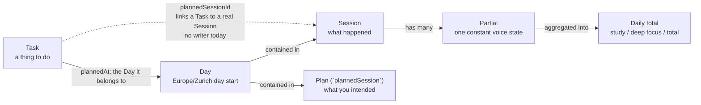
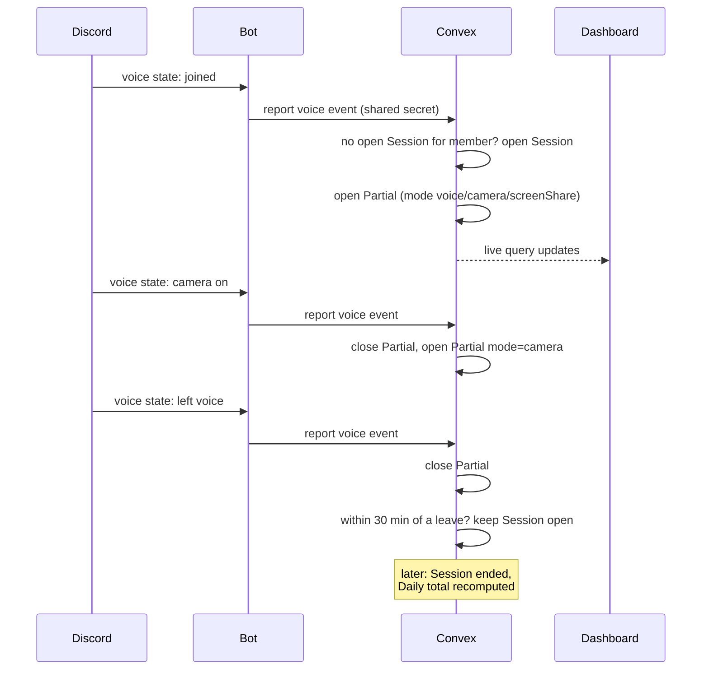
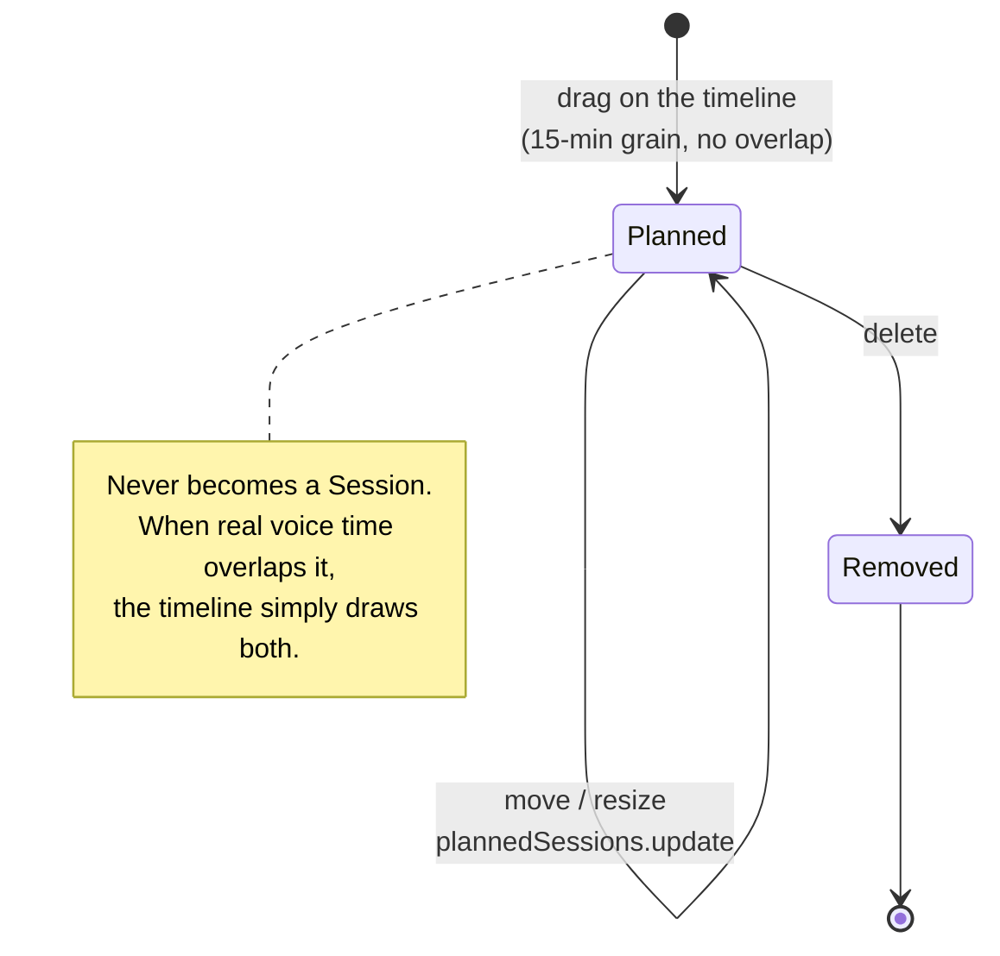
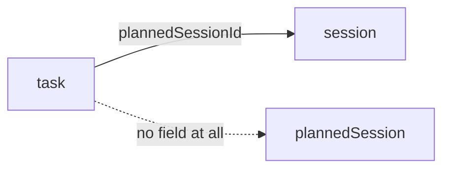
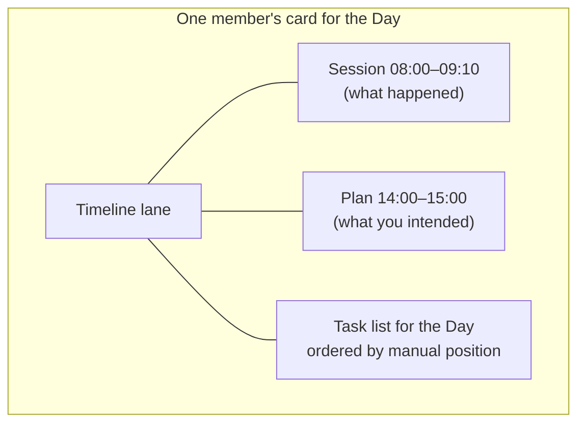

# Session vs Plan (and where Tasks sit)

Reference note for the three time-ish things in studytrack. The short version:
a **Session** is what happened; a **Plan** is what you intended to happen; a
**Day** is the box both of them live in.

> Source of truth: `packages/backend/convex/schema.ts` and `GLOSSARY.md`.

## The four nouns

- **Day** — `dayStart`, always local midnight in Europe/Zurich. Tasks and plans
  are scoped to a Day. It keeps the backend reading `dayStart` from the caller
  instead of the wall clock.
- **Session** — a real sitting (`schema.ts:25`). It starts when a member joins a
  study voice channel and ends when they leave voice; re-entering within 30
  minutes continues the same one. It is made of **Partials**.
- **Partial** — one stretch with a constant voice state: same channel, same
  camera / screen-share mode. Pauses (no channel) are partials too.
- **Plan** — stored in the `plannedSession` table (`schema.ts:100`). A future
  block on your own lane: `dayStart`, `plannedStart`, `plannedEnd`. It has **no
  voice evidence and no partials**. It is a promise, not a record.
- **Task** — `schema.ts:81`. Belongs to a Day (`plannedAt`), and _optionally_
  points at a real Session (`plannedSessionId`).

## A real Session forms

The bot only reports raw voice states; Convex decides what they mean.

## A Plan is placed, not observed

## The two things that confuse people

**1. `task.plannedSessionId` points at a real `session`, not at
`plannedSession`.**

That is deliberate in spirit — "I did this task during that sitting" — but
nothing writes it today. `sessions/util.ts:74` reads it, tests set it, no
mutation does. So a Task can be planned for a **Day**, and can be marked as done
at a time, but cannot yet be attached to a **Plan**. Attaching a Task to a Plan
is the feature that does not exist yet, and it will need a new field (or a new
join table) — `plannedSessionId` cannot be reused for it.

**2. "Planned session" is a table name, not a domain term.** In conversation the
block on the timeline should be called a **Plan**. Keep "Session" for the real
sitting. Proposed glossary entry:

> **Plan**: A future block of study time a member places on their own lane — a
> Day, a start, an end. Has no voice evidence. Turning into a Session is not a
> transition; it is only ever an intention. _Avoid_: planned session, plan
> block, calendar entry.

## What the dashboard draws

Sessions and Plans share the lane because they answer the same question —
"what is on my day?" — but they come from different tables and are never
merged. A member with only Plans and no Sessions still gets a card
(`sessions/service.ts:221`).

## Related

- `GLOSSARY.md` — Session, Partial, Pause, Day vocabulary.
- `docs/adr/0004-session-is-the-trunk.md` — why Session is the trunk.
- `docs/adr/0008-timeline-shows-one-day.md` — the Day-scoped timeline.
- `docs/adr/0007-task-content-is-public.md` — task titles are public.
