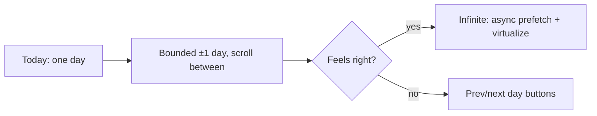

# Multi-day scroll

#parked

**In short:** the day timeline shows one Day. The direction is to let it scroll sideways into adjacent days — HEY-calendar style, each day a repeat of the unit we already have. **Parked**: it is a re-architecture, not a ticket, and it collides with the drag gestures. This note keeps the shape and the open questions so a future session does not start from zero.

## Why it is closer than it looks

The axis is already a **list of segments**, not "a day". `TimelineSegment[]` today is `[band(00:00–06:00), core(06:00–24:00)]`; two days abutting is just `[…day0, band(day1), core(day1), …]` — day0's core ends at 24:00, day1's band starts at 00:00, so the axis stays **contiguous with no gap**. Every pure helper (`segmentAt`, `forEachVisibleSpan`, `buildTicks`, `minuteToPx`) already walks segments by cumulative offset, and the whole thing is tz-free and clock-free by construction. So the maths generalises; the cost is elsewhere.

## The shape

Each day keeps exactly the unit decided in [[Timeline expansion spec]] and ADR-0008: a collapsible night (`00:00–06:00`) then a full-scale core (`06:00–24:00`). The axis becomes a sequence of those units, and the rhythm reads as `▮ Mon ▮ Tue ▮ Wed` — each night a thin strip you can open.

## The four sharp edges

1. **Minutes become absolute.** Everything keys on minutes-from-day-start, which collides across days. It has to become minutes-from-window-start (`dayIndex * 1440 + min`). Contained refactor of `timeline/util.ts` and `pxToMinute.ts`; the vitest suite protects it.
2. **Async prepend shifts every offset.** Loading yesterday to the left inserts width at the front, so everything jumps right. Fix by measuring before/after and adding the delta to `scrollLeft` (and mirroring it in the pinned bar). Fiddly, solvable — this is the genuinely annoying part.
3. **The sizing model flips.** Today px/hour is "squeeze the day to fit the viewport, floor 32px/h". You cannot fit N days, so it becomes a **fixed px/hour, always scroll**. Arguably less code — but it retires the "one day fits the laptop" promise.
4. **Gestures collide.** Drag-to-pan on the room _is_ horizontal scroll, and horizontal drag on your lane is already drag-to-plan (LD-6). Riskiest part, and it is UX, not maths.

Plus a **per-day Convex query** (today's is day-scoped) and **virtualization** so loaded days do not all mount.

## Open questions

- **Infinite, or just "not walled off"?** Bounded (±1 day, scroll between, prefetch on approach) may buy ~90% of the feeling for a fraction of the machinery.
- **Sizing:** fixed px/hour (accept losing fit-to-width) vs something else.
- **Auto-open per day:** "open the night only if now is inside it" is the consistent rule; keeping a morning cushion is the softer alternative.
- **Gestures:** resolve drag-to-pan vs infinite scroll vs drag-to-plan before writing the spec.

## Staging

Prototype first against the mock scenarios (2–3 days, async simulated) — the sizing and gesture questions are decided by feel, not on paper. Only if it survives does it become a spec note that **extends** [[Timeline expansion spec]], not a mutation of it.

## Related

- [[Timeline expansion spec]] · [[Lanes of the day]] · [[Future-session planning]] · [[Roadmap]]
