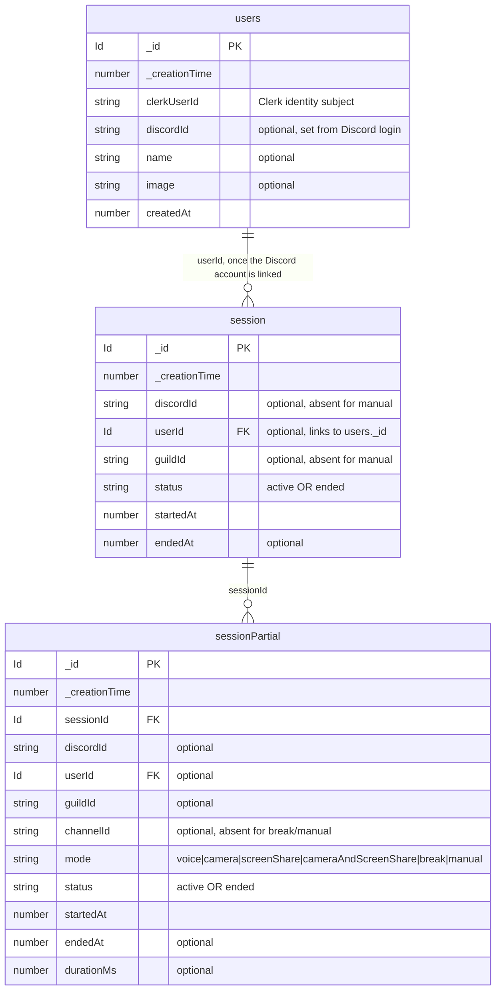
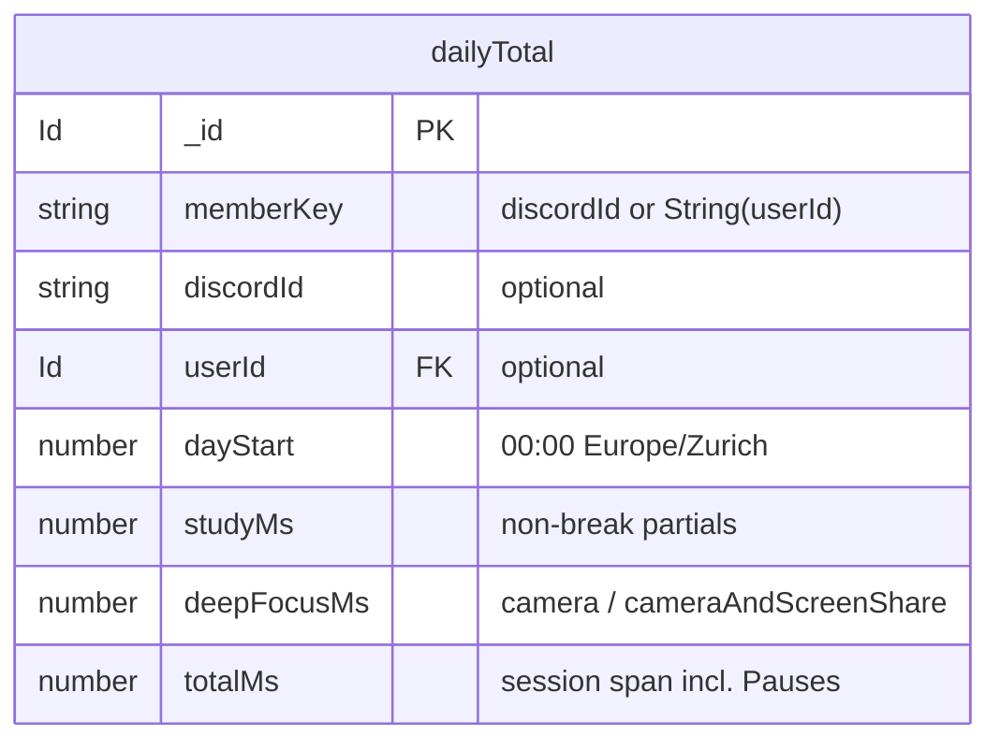

# studytrack — data model

Current Convex schema. Source of truth: `packages/backend/convex/schema.ts`.

`_id` and `_creationTime` are added to every table automatically by Convex.

## Indexes

- `users`: `by_clerkUserId` (clerkUserId) · `by_discordId` (discordId)
- `session`: `by_status` (status) · `by_discordId` (discordId, status) · `by_userId` (userId, status)
- `sessionPartial`: `by_sessionId` (sessionId, status) · `by_status` (status) · `by_discordId` (discordId, status) · `by_userId` (userId, startedAt) · `by_startedAt` (startedAt)
- `dailyTotal`: `by_dayStart` (dayStart) · `by_memberKey` (memberKey, dayStart)

A **session** is the whole sitting; its **partials** are the stretches of constant
voice state. A partial's `mode` is one of `voice`, `camera`, `screenShare`,
`cameraAndScreenShare`, `break` (a pause), or `manual` (declared from the web).
`discordId`/`guildId` are optional so a manually tracked session, which has no
Discord evidence, can exist.

A **dailyTotal** row is one member's Study time, Deep focus and Total time for one
closed Day, keyed by `memberKey` (`discordId ?? String(userId)`). It is a derived
cache, not a source of truth: `rollupDay` recomputes a Day from raw partials,
clipped to `[dayStart, dayEnd)`; a cron (`1 * * * *`) re-rolls the last two closed
Days; `backfill` fills history. Every Period and Consistency read is a sum over
these rows, so no reader rescans partials.

> **Guild settings removed for now.** Every voice channel counts as a study
> channel, so there is no per-server config table.

## Diagram

## Derived (ST-11)

`dailyTotal` is the one derived table, written only by the `dailyTotals` domain:

`dayStart` is derivable from `_creationTime`; `memberKey` soft-links to `users`
(it is not a hard foreign key).

## Tasks (ST-5, shipped)

The `task` table holds each member's private list: `title`, `done`,
`completedAt` (optional), owner `userId`. Only counts are shared with the room
(see `docs/adr/0002`). Rename/delete landed in ST-16.
