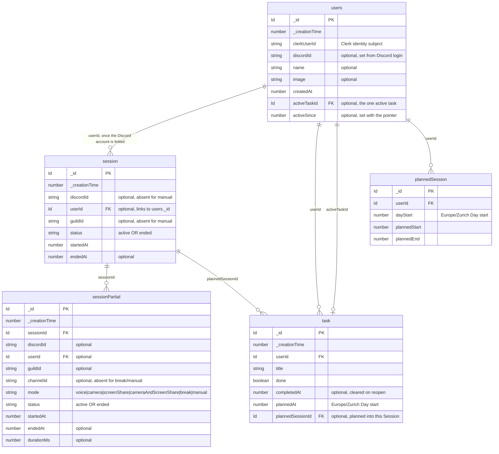
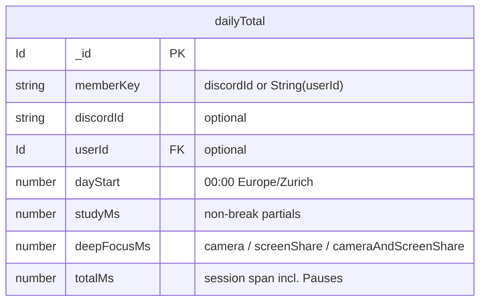

# studytrack — data model

**In short:** the Convex schema — `users`, `session`, `sessionPartial`, the
derived `dailyTotal` (one member's totals per Day) and `task` (a member's plan).
Source of truth: `packages/backend/convex/schema.ts`.

Current Convex schema. Source of truth: `packages/backend/convex/schema.ts`.

`_id` and `_creationTime` are added to every table automatically by Convex.

## Indexes

- `users`: `by_clerkUserId` (clerkUserId) · `by_discordId` (discordId)
- `session`: `by_status` (status) · `by_discordId` (discordId, status) · `by_userId` (userId, status)
- `sessionPartial`: `by_sessionId` (sessionId, status) · `by_status` (status) · `by_discordId` (discordId, status) · `by_userId` (userId, startedAt) · `by_startedAt` (startedAt)
- `dailyTotal`: `by_dayStart` (dayStart) · `by_memberKey` (memberKey, dayStart)
- `task`: `by_userId` (userId) · `by_userId_plannedAt` (userId, plannedAt) · `by_userId_completedAt` (userId, completedAt) · `by_plannedSessionId` (plannedSessionId)
- `plannedSession`: `by_userId_dayStart` (userId, dayStart) · `by_dayStart` (dayStart)

A **session** is the whole sitting; its **partials** are the stretches of constant
voice state. A partial's `mode` is one of `voice`, `camera`, `screenShare`,
`cameraAndScreenShare`, `break` (a pause), or `manual` (declared from the web).
`discordId`/`guildId` are optional so a manually tracked session, which has no
Discord evidence, can exist.

A **dailyTotal** row is one member's Study time, Deep focus and Total time for one
closed Day, keyed by `memberKey` (`discordId ?? String(userId)`). It is a derived
cache, not a source of truth: `rollupDay` recomputes a Day from raw partials,
clipped to `[dayStart, dayEnd)`; a cron (`1 * * * *`) re-rolls the last two closed
Days; `backfill` fills history. Every Period and Consistency read is a sum over
these rows, so no reader rescans partials.

> **Guild settings removed for now.** Every voice channel counts as a study
> channel, so there is no per-server config table.

## Diagram

## Derived (ST-11)

`dailyTotal` is the one derived table, written only by the `dailyTotals` domain:

`dayStart` is derivable from `_creationTime`; `memberKey` soft-links to `users`
(it is not a hard foreign key).

## Tasks (ST-5, ST-27)

The `task` table is each member's plan. Task content is public (ADR-0007): titles,
the active task and the up-next suggestion show in the room without a per-task
privacy flag. Only the owner writes.

- `plannedAt` is the Europe/Zurich Day the task is planned for — always a day
  start, never a time. `listMine({ dayStart })` reads exactly that Day, oldest
  first by `_creationTime`, so a new task lands at the bottom.
- `plannedSessionId` is an explicit plan into a real Session, not inferred from
  time overlap. A Session card shows one deduped entry per task: `planned` and/or
  its `completedAt` when the task was finished inside that Session. A task
  planned in one Session and finished in another appears in both, with different
  state.
- `done`/`completedAt` are the completion state; `completedAt` is cleared on
  reopen. It is also what binds a completion to the Session whose span contains
  it. Reopening removes the task from that Session's finished set.
- The member's one active task lives on `users.activeTaskId`, with `activeSince`,
  not on the task row. It clears when the task is completed, deleted, or
  explicitly cleared; creating or completing other work never moves it. Active is
  user-level, not Session-scoped (Session-scoped clearing is deferred until real
  tracking exists).
- Up-next is derived, never stored: the first Open task below the active row in
  the oldest-first Day list, or the first Open task when none is active. It never
  auto-starts.

Rename/delete landed in ST-16. Day planning and the active pointer landed in
ST-27.

## Planned sessions

A **planned session** is not a Session: it has no voice evidence and no
partials. It is the dashed block on a member's lane, created by dragging across
their own line.

- `plannedSession` is one row per block, so a member may have several plans at
  once. Dragging again **creates** another block instead of moving an existing
  one. Plans for the same member and Day may touch but never overlap; the
  mutation refuses an overlap.
- `dayStart` is the Europe/Zurich Day the plan belongs to; `plannedStart` and
  `plannedEnd` are the instants of the block, both on the 15-minute grid.
- The mutation refuses a start in the past and a window outside its Day. Plans
  are public (ADR-0007), so `getTodaysActivitiesForDashboard` attaches them to
  the member's card (`plans`, oldest first) and appends a card for a plan-only
  member.
- The timeline draws each plan as a dashed block. A plan whose window has ended
  with no overlapping non-break voice time renders as **missed**.
