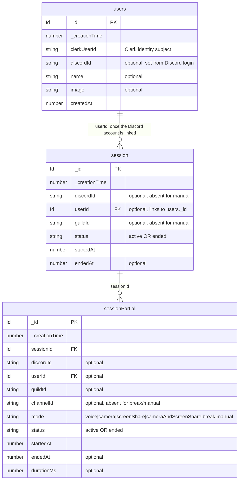

# studytrack — data model

Current Convex schema. Source of truth: `packages/backend/convex/schema.ts`.

`_id` and `_creationTime` are added to every table automatically by Convex.

## Indexes

- `users`: `by_clerkUserId` (clerkUserId) · `by_discordId` (discordId)
- `session`: `by_status` (status) · `by_discordId` (discordId, status) · `by_userId` (userId, status)
- `sessionPartial`: `by_sessionId` (sessionId, status) · `by_status` (status) · `by_discordId` (discordId, status) · `by_userId` (userId, startedAt) · `by_startedAt` (startedAt)

A **session** is the whole sitting; its **partials** are the stretches of constant
voice state. A partial's `mode` is one of `voice`, `camera`, `screenShare`,
`cameraAndScreenShare`, `break` (a pause), or `manual` (declared from the web).
`discordId`/`guildId` are optional so a manually tracked session, which has no
Discord evidence, can exist.

> **Guild settings removed for now.** Every voice channel counts as a study
> channel, so there is no per-server config table.

## Diagram

## Planned (ST-5)

A `task` table will hold each member's private list: `title`, `done`,
`completedAt` (optional), owner `userId`. Only counts are shared with the room
(see `docs/adr/0002`).
