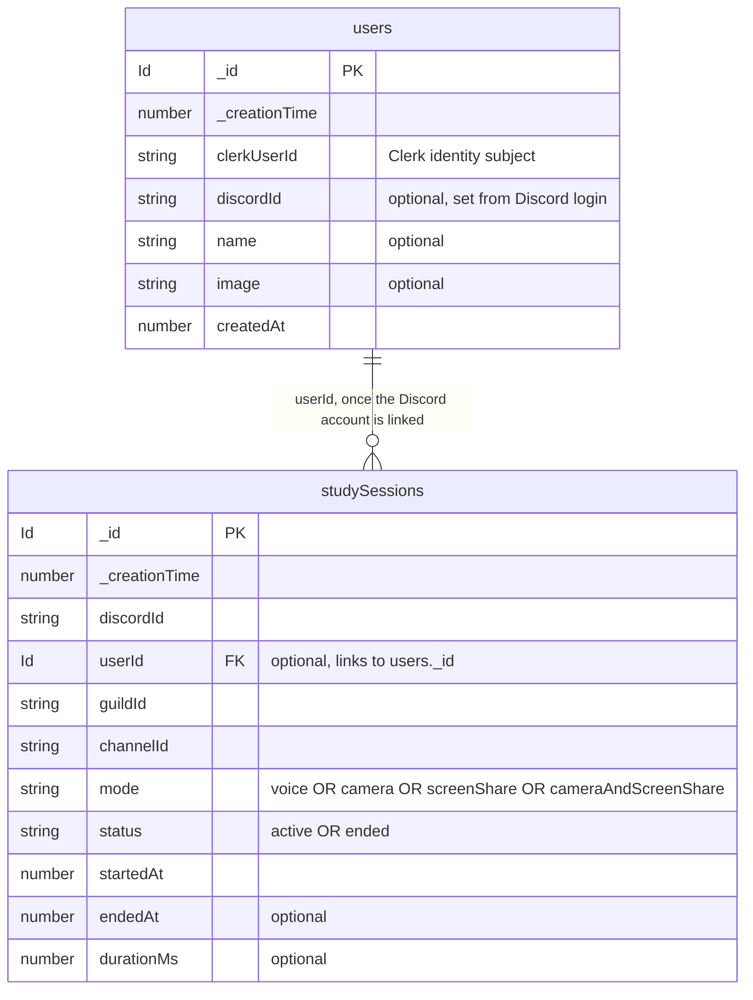

# studytrack — data model

Current Convex schema. Source of truth: `packages/backend/convex/schema.ts`.

`_id` and `_creationTime` are added to every table automatically by Convex.

> **Guild settings removed for now.** Every voice channel counts as a study
> channel, so there is no per-server config table. When settings come back, one
> of their fields will be the **channel ID** (the channels that count as study).

## Indexes

- `users`: `by_clerkUserId` (clerkUserId) · `by_discordId` (discordId)
- `studySessions`: `by_status` (status) · `by_discordId` (discordId, status) · `by_userId` (userId, startedAt)

## Diagram

